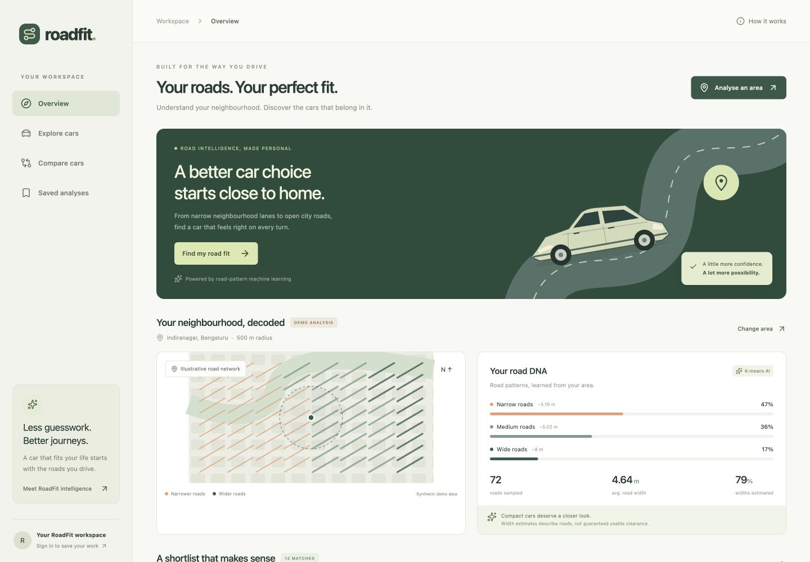
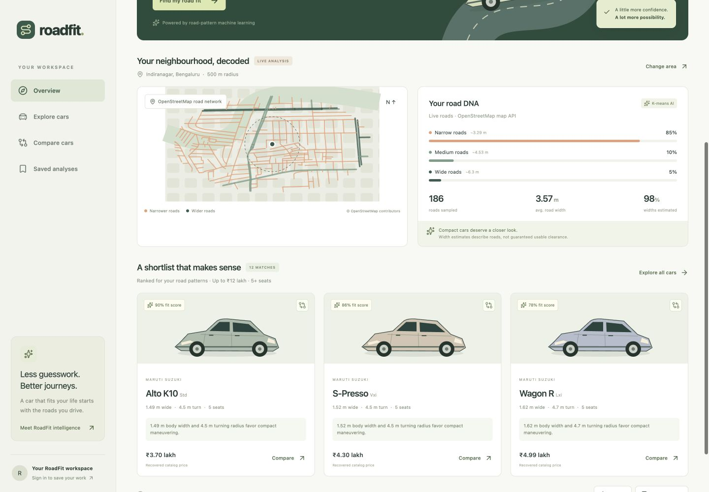
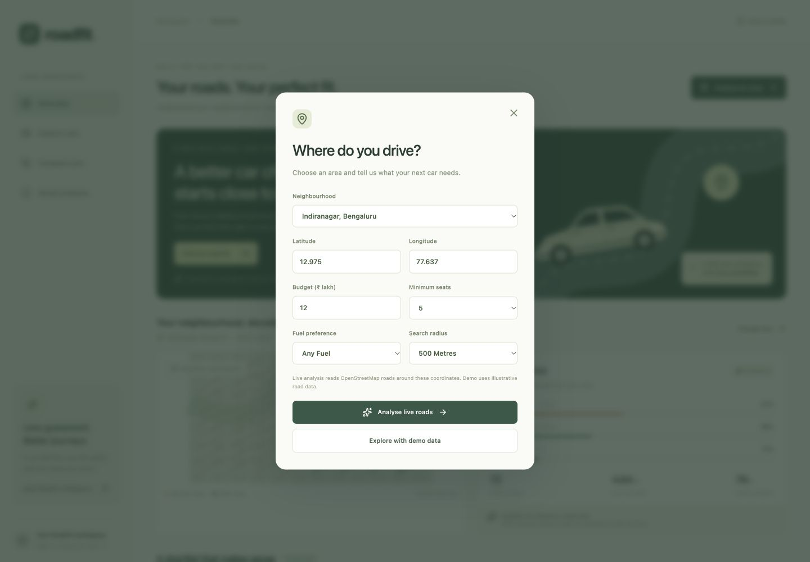
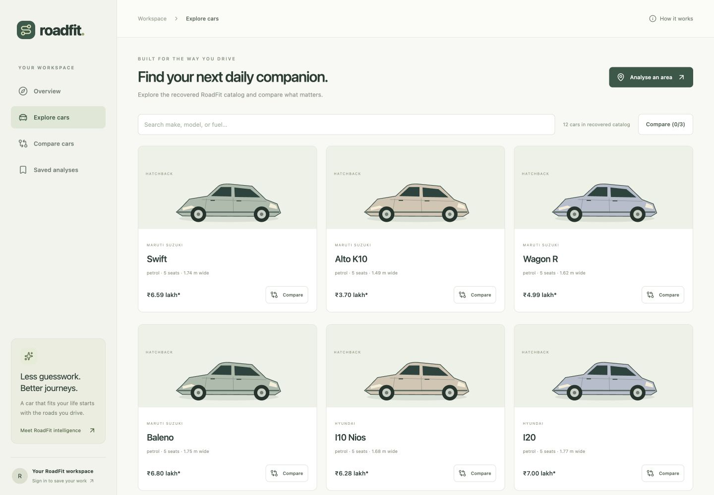
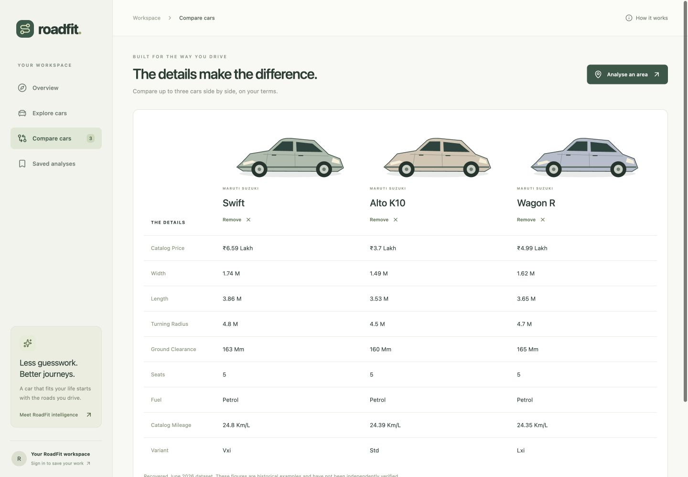
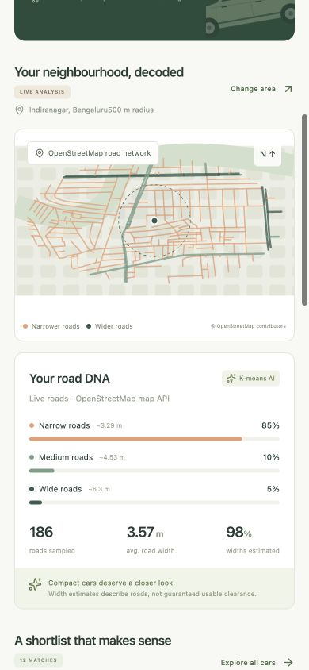
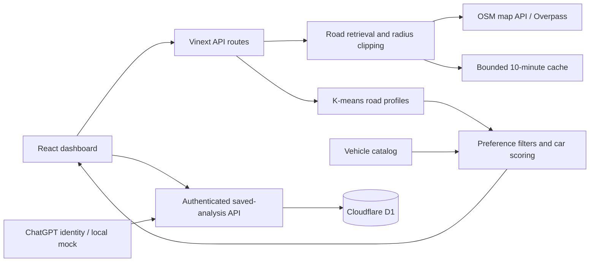

<h1 align="center">RoadFit</h1>

<p align="center">
  <strong>Your roads. Your perfect fit.</strong><br />
  Understand your neighbourhood. Discover the cars that belong in it.
</p>

<p align="center">
  
  
  
  
</p>

<p align="center">
  <a href="#feature-gallery">Screenshots</a> ·
  <a href="#quick-start">Quick start</a> ·
  <a href="#how-the-ai-works">How the AI works</a> ·
  <a href="#api">API</a>
</p>

<p align="center">
  
  <br /><sub>The desktop dashboard, shown in the explicitly labeled demo mode.</sub>
</p>

RoadFit helps you compare cars against the roads you actually drive. Choose a neighbourhood, analyse nearby OpenStreetMap roads, and explore a shortlist based on road patterns, vehicle dimensions, budget, seating, and fuel preference.

> **Project status:** A working full stack prototype with live road analysis, an offline-data demo, and account-based saved analyses. The catalog contains 12 historical vehicle entries from June 2026; prices and specifications require independent verification. No AI API key is needed.

## Contents

- [Highlights](#highlights)
- [Feature gallery](#feature-gallery)
- [How the AI works](#how-the-ai-works)
- [Architecture](#architecture)
- [Tech stack](#tech-stack)
- [Quick start](#quick-start)
- [Configuration and authentication](#configuration-and-authentication)
- [Development and checks](#development-and-checks)
- [API](#api)
- [Troubleshooting](#troubleshooting)
- [Data and current scope](#data-and-current-scope)
- [Repository map](#repository-map)

## Highlights

- **Live road intelligence:** analyse a 500 m, 1 km, or 1.5 km area using OpenStreetMap map exports and Overpass, with provider fallback and a bounded 10-minute cache.
- **Explainable road DNA:** K-means groups road widths into relative patterns, with the sampled-road count, average width, and estimated-width percentage visible in the dashboard.
- **Personalised car matching:** filter by budget, minimum seats, and fuel; rank eligible cars using compactness, turning radius, catalog mileage, and resale scores.
- **Search and compare:** search the car catalog and compare up to three vehicles side by side, including dimensions, ground clearance, seating, and historical price.
- **Save and export:** save analyses to your account in Cloudflare D1, reopen or delete them later, and export the current analysis as JSON.
- **Demo without a road provider:** explore an explicitly labeled synthetic road dataset when public map services are unavailable.
- **Responsive interface:** a desktop workspace and compact mobile layout built around the same analysis flow.

## Feature gallery

Actual application screenshots captured on 29 October 2026. The overview above uses demo data; the road-analysis screenshot below uses live OSM geometry for Indiranagar, Bengaluru. Width estimates remain labeled in both modes.

<table>
  <tr>
    <td align="center" width="50%">
      <a href="docs/screenshots/live-analysis.jpg"></a><br />
      <strong>Roads, decoded</strong><br />
      Inspect live geometry, road-width clusters, and the proportion of estimated widths.
    </td>
    <td align="center" width="50%">
      <a href="docs/screenshots/preferences.jpg"></a><br />
      <strong>Your area. Your priorities.</strong><br />
      Choose where you drive and what your next car needs.
    </td>
  </tr>
  <tr>
    <td align="center" width="50%">
      <a href="docs/screenshots/catalog.jpg"></a><br />
      <strong>A catalog to explore</strong><br />
      Browse historical vehicle specifications and build a comparison shortlist.
    </td>
    <td align="center" width="50%">
      <a href="docs/screenshots/comparison.jpg"></a><br />
      <strong>The details, side by side</strong><br />
      Compare up to three cars using the same specification table.
    </td>
  </tr>
</table>

<details>
  <summary><strong>See the mobile road-analysis view</strong></summary>
  <p align="center">
    
    <br /><sub>The responsive web app at a mobile viewport; this is not a separate native app.</sub>
  </p>
</details>

## How the AI works

RoadFit uses **unsupervised K-means machine learning** to understand road-width patterns. Car ranking is a separate, transparent heuristic. There is no generative AI chatbot or external model API.

1. **Read nearby roads.** Fetch drivable OSM ways around the selected coordinates, reconstruct geometry where necessary, and clip it to the chosen radius. Explicit `access=no` and `motor_vehicle=no` ways are excluded.
2. **Prepare width data.** Parse available width tags, including metres and feet. Missing or invalid widths use a road-type estimate, which is counted and disclosed in the interface.
3. **Learn the patterns.** Cluster widths into up to three groups. The clusters are ordered from narrower to wider within that sample; uniform or small samples use fewer groups.
4. **Filter the catalog.** Keep only vehicles that satisfy the budget, seat count, and fuel preference.
5. **Rank and explain.** Score eligible cars using body width, turning radius, catalog mileage, and the catalog's resale score. A greater share in the narrower cluster increases the emphasis on compactness.

A fit score is a relative comparison, **not a probability, safety rating, or guarantee that a car can pass along a road**. Samples count OSM ways, rather than road length, and widths do not establish usable clearance.

## Architecture



The application runs as a Cloudflare Worker when hosted. Browser interactions call server routes; public road-provider requests, clustering, scoring, and database access happen on the server. Saved-analysis queries are scoped to the authenticated user's ID.

## Tech stack

| Layer | Technology |
| --- | --- |
| Interface | React 19, TypeScript, responsive CSS, Lucide icons |
| Application runtime | Vinext, Vite 8, Cloudflare Workers |
| Validation | Zod |
| Database | Cloudflare D1 with Drizzle ORM and SQL migrations |
| Road data | OpenStreetMap map API and Overpass |
| Machine learning | Server-side K-means implementation in TypeScript |
| Identity | Platform-provided ChatGPT sign-in; local development mock |

## Quick start

### Prerequisites

- **Node.js 22.13 or newer** and npm.
- Git to clone the repository.
- Internet access for dependency installation and live road analysis. Demo analysis uses bundled data.

### 1. Clone and install

```bash
git clone https://github.com/RishabhSingh9093/RoadFit.git
cd RoadFit
npm ci
```

### 2. Build the application

The build generates the Worker configuration used by the local database tool.

```bash
npm run build
```

### 3. Initialize the local database

Apply the included initial migration once for a fresh local database:

```bash
node --import ./scripts/sites-env.mjs ./node_modules/wrangler/bin/wrangler.js d1 execute DB --local --config dist/server/wrangler.json --persist-to .wrangler/state --file drizzle/0000_conscious_mongu.sql
```

Local database state lives under the ignored `.wrangler/state/` directory. Reapply migrations only when they have not already been applied to that database.

### 4. Start RoadFit

```bash
npm run dev
```

Open **[http://127.0.0.1:5180](http://127.0.0.1:5180)**, or the local URL printed by the development server. Keep the terminal running.

Choose **Analyse an area → Analyse live roads** to fetch actual map data. Choose **Explore with demo data** to use the illustrative dataset. The initial overview opens in demo mode.

## Configuration and authentication

**No `.env` file, OpenAI key, or paid map API key is required for the current app.**

| Concern | Current behaviour |
| --- | --- |
| Development port | `5180`, configured in the `dev` script in `package.json` |
| Database binding | `DB`, declared in `.openai/hosting.json` |
| Local database | Separate from the hosted database; initialized with the SQL migration above |
| Live providers | Public OSM endpoints configured in `lib/roads.ts` |
| Clustering | Runs directly on the server; no external AI service |
| Local sign-in | Simulated identity for loopback development requests |
| Hosted sign-in | Supplied by the Sites platform; hosting identity must be configured if deployed elsewhere |

To exercise saved analyses locally, use the app's **Sign in to save your work** link. The local mock is a development convenience, not a production authentication system. Platform sign-in routes are not a general-purpose OAuth implementation for arbitrary hosts.

The API test script accepts `ROADFIT_TEST_URL` from the shell environment. It does **not** automatically load a `.env` file.

## Development and checks

| Command | Purpose |
| --- | --- |
| `npm run dev` | Start the local development server on port 5180. |
| `npm run build` | Generate the production Worker and client assets. |
| `npm start` | Preview the built Worker locally; use its printed URL. |
| `npx tsc --noEmit` | Check TypeScript. |
| `node tests/engine.cjs` | Check clustering, scoring, width parsing, geometry clipping, caching, and provider fallback. |
| `node tests/api-smoke.mjs` | Exercise API validation, authentication checks, and local D1 save/list/delete while the dev server is running. |
| `npm run db:generate` | Generate a new SQL migration after changing the Drizzle schema. |

For API checks, keep `npm run dev` running and use a second terminal:

```bash
node tests/api-smoke.mjs
```

The API smoke script reports live-provider availability separately. A passing demo/database check does not, by itself, establish that an external road provider is online.

## API

| Method | Endpoint | Purpose |
| --- | --- | --- |
| `POST` | `/api/analyse` | Analyse live or demo roads and return a profile, matches, preferences, location, and timestamp. |
| `GET` | `/api/catalog` | Return the vehicle catalog and its provenance. |
| `GET` | `/api/saved` | List the current user's latest 50 saved analyses. |
| `POST` | `/api/saved` | Save an analysis for the authenticated user. |
| `DELETE` | `/api/saved?id=...` | Delete the authenticated user's matching saved record. |

Try a demo analysis without contacting a road provider:

```bash
curl http://127.0.0.1:5180/api/analyse \
  -H 'Content-Type: application/json' \
  --data '{"mode":"demo","lat":12.975,"lng":77.637,"radius":500,"budget":12,"seats":5,"fuel":"any","name":"Indiranagar, Bengaluru"}'
```

Change `"mode":"demo"` to `"mode":"live"` to fetch current OSM geometry. Live profiles include the provider and retrieval time. Supported radii are `500`, `1000`, and `1500` metres; budget is expressed in lakh rupees.

## Troubleshooting

| Symptom | What to check |
| --- | --- |
| Port 5180 is already in use | Stop the earlier RoadFit process with **Ctrl+C**, or start another port with `node scripts/run-framework.mjs dev --port 5181`. |
| Road provider unavailable | Check internet access, try a 500 m radius, or use demo mode. Public services can be busy; live mode never silently substitutes synthetic data. |
| Saved analyses unavailable | Initialize the local database, then sign in through the local development link. |
| `table analyses already exists` during setup | The initial migration is already applied to this local database; continue with `npm run dev`. |
| Missing dependencies or unsupported Node | Check `node --version`, use Node 22.13+, and run `npm ci` from the repository root. |

## Data and current scope

- **Historical catalog:** the 12 bundled vehicle entries originate from the June 2026 project dataset. Prices and specifications are unverified historical examples, not current manufacturer quotes. Car illustrations are generic vectors, not model photographs.
- **Estimated widths:** OSM often lacks width tags. Road-type estimates are disclosed and do not account for parking, obstacles, road damage, or traffic. A live test for the Bengaluru example returned 186 ways, with 182 estimated widths; results can change as map data changes.
- **No navigation guarantee:** RoadFit compares road patterns and vehicle characteristics. It does not provide turn-by-turn routing or establish legal or safe passage.
- **Public service limits:** requests use provider deadlines, a bounded in-memory cache, and a 12 MB response limit. Cache state is per server instance. High-volume deployments should use a dedicated OSM data service.
- **Demo provenance:** synthetic geometry is clearly marked. Live road-data failures remain errors rather than being disguised as successful demo results.

Map data: **© [OpenStreetMap contributors](https://www.openstreetmap.org/copyright)**. See the [OSM map API documentation](https://wiki.openstreetmap.org/wiki/API_0.6) and [public Overpass instances](https://wiki.openstreetmap.org/wiki/Overpass_API).

## Repository map

| Path | Responsibility |
| --- | --- |
| `app/dashboard.tsx` | Dashboard, preferences, car catalog, comparison, and saved-analysis views. |
| `app/api/` | Analysis, catalog, and authenticated saved-analysis routes. |
| `app/chatgpt-auth.ts` | Platform identity helpers and sign-in paths. |
| `lib/roads.ts` | Provider retrieval, OSM geometry reconstruction, radius clipping, cache, and fallback. |
| `lib/engine.ts` | Width parsing, K-means clustering, profile summaries, and car scoring. |
| `lib/cars.json` | Historical vehicle catalog. |
| `db/` | Drizzle schema and D1 connection. |
| `drizzle/` | Generated SQL migrations and schema metadata. |
| `tests/` | Engine and local API checks. |
| `docs/screenshots/` | Application screenshots used in this README. |
| `worker/` | Hosted Worker entrypoint. |
| `scripts/` | Build, development, environment, and platform integration helpers. |

<p align="center">
  <sub>Road intelligence · Explainable machine learning · Car comparison · React · TypeScript · OpenStreetMap · Cloudflare D1</sub>
</p>
